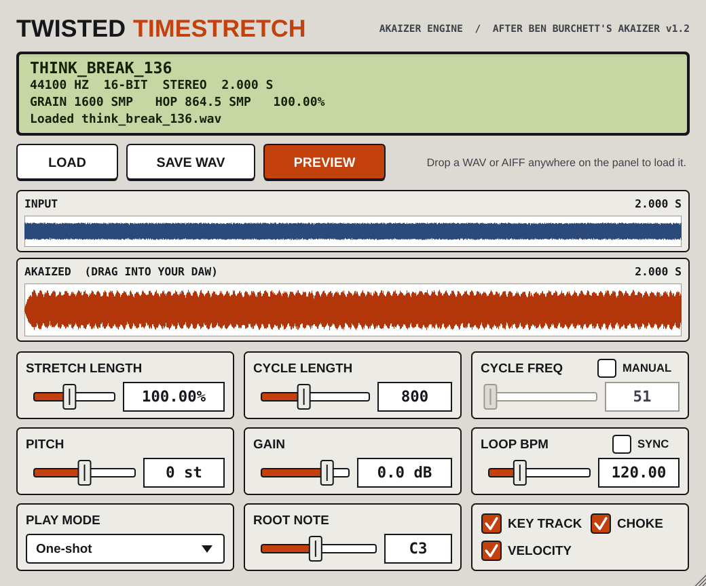

# TWISTED TIMESTRETCH

**Akaizer as an Audio Unit.** A faithful C++ port of Ben Burchett's
*Akaizer v1.2* (the Windows-only Visual Basic timestretcher behind a
generation of jungle and drum & bass breaks), rebuilt as an
**AU / VST3 instrument and a standalone Mac app** with JUCE 8.

The stretch routine was recovered from the original `Akaizer.exe` machine
code and ported line for line, quirks included. The test suite checks it
sample for sample against an independent browser port (`web/Akaizer.html`).



## Install (no building needed)

Every green build publishes a release. Open **Releases** on the right of the
repo page, download **TwistedTimestretch-macOS.zip** from the newest one and
follow `INSTALL.txt` inside:

* `TwistedTimestretch.component` → `~/Library/Audio/Plug-Ins/Components/` (Logic, GarageBand, Ableton…)
* `TwistedTimestretch.vst3` → `~/Library/Audio/Plug-Ins/VST3/`
* `Twisted Timestretch.app` → `/Applications` (works without a DAW)
* clear macOS quarantine with the `xattr` lines in `INSTALL.txt`, then rescan

Universal binary (Apple Silicon + Intel), macOS 11 or later.

## Using it

1. **Load** a sample: drop a WAV / AIFF / FLAC anywhere on the panel, or press **LOAD**.
2. Set **STRETCH LENGTH**, **CYCLE LENGTH** and **CYCLE FREQ**, the same three
   controls as the original. It re-renders in the background as you move them.
3. Play it from MIDI, or press **PREVIEW**.
4. Get the audio out: **drag the orange waveform into your DAW**, or **SAVE WAV**
   (`yourfile_akaized.wav`, 16-bit, exactly what Akaizer would have written).

| Control | What it does |
|---|---|
| STRETCH LENGTH | 25 – 2000 %. New length as a percentage of the original. |
| CYCLE LENGTH | 20 – 2000 samples. Each grain is twice this long (half-sine window). |
| CYCLE FREQ | 20 – 2050 cps. How often grains are laid down (sample rate ÷ this). Linked to `41000 ÷ cycle length` like the original until you tick **MANUAL**. |
| PITCH | ±24 semitones of sampler-style repitch *before* stretching. The final length stays at STRETCH %, so "pitch up, stretch back to length" is one move. |
| LOOP BPM + SYNC | With SYNC on, STRETCH follows the host: `loop BPM ÷ host BPM`. The loop BPM is guessed from the sample length on load. In the standalone app (no host) the box shows **LOOP** and **TO** fields: SYNC stretches the loop to the TO tempo. |
| PLAY MODE | One-shot (plays to the end), Gate (stops on key up), Loop (loops while held). |
| ROOT NOTE / KEY TRACK | Root plays at original pitch; with KEY TRACK on, other keys repitch like a sampler. |
| CHOKE | A new note cuts the previous one (mono, as for breaks). |
| VELOCITY / GAIN | Velocity sensitivity and output level. |

### The standalone app

`Twisted Timestretch.app` is the whole instrument without a DAW, which is
the closest thing to the original Akaizer on a Mac: load a break, set the
tempo it's at (LOOP) and the tempo you want (TO), tick SYNC, press PREVIEW,
then SAVE WAV. A MIDI keyboard plays it too: pick it, and the sound card,
under **Options > Audio/MIDI Settings** at the top of the window. The app
remembers the last sample and settings between launches.

The sample is saved inside your project, so sessions open on another machine
without the original file.

## How the algorithm works

```
L  = CycleLength * 2 * Channels                ' grain length (interleaved words)
C  = round(Channels * SampleRate / CycleFreq)  ' output hop
nOut = round(nIn * Stretch / 100)
S  = round(nIn / (nOut / C))                   ' input hop
for k = 0 .. round(nOut / C - 1)
    for j = 0 .. L - 1  (stop at either buffer's end)
        out[C*k + j] = clip16(round(in[S*k + j] * sin((j+1) * 3.141592654 / L) + out[C*k + j]))
```

Rounding is round-half-even (VB6 `FpI4`). Linked frequency uses **41000**, not
44100, as shipped. Stereo is processed interleaved, so an odd hop can swap
left and right between grains. That's part of the original sound and is kept.

## Building

GitHub Actions builds, tests and validates every push (`.github/workflows/build.yml`):
unit tests, UI snapshot, `auval -strict`, a host round trip through the AU and
VST3, and pluginval (strictness 7). Pushes to `main` publish a release.

Local build:

```
cmake -B build -S . -DCMAKE_BUILD_TYPE=Release
cmake --build build --config Release -j 8
./build/TwistedTimestretchTests_artefacts/Release/TwistedTimestretchTests
```

`Tests/reference/genref.js` regenerates the reference vectors from `web/Akaizer.html`.

## Credits

Akaizer v1.2 was developed by Ben Burchett (2006). This is an independent port
for macOS; the original program is not included.
